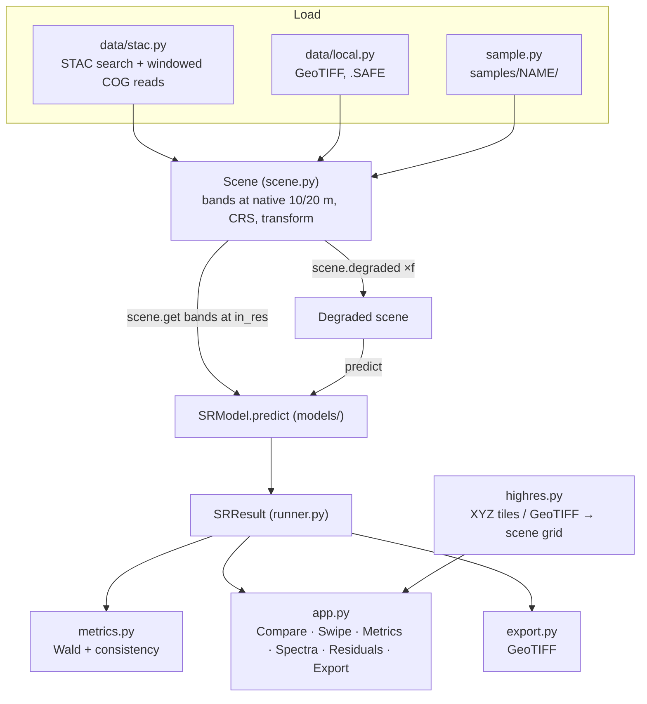

# Architecture

Back to [Home](Home.md)

## Data flow



## Modules

| Path | Responsibility |
|---|---|
| `app.py` | Streamlit UI: sidebar workflow, tabs, caching of loaded models (`st.cache_resource`) |
| `s2sr/bands.py` | Band names, native resolutions, wavelengths, MTF values, colour composites, STAC asset keys |
| `s2sr/scene.py` | `Scene`: per-band arrays at native resolution; `get()` resamples to a model's grid; `degraded()` implements the Wald degradation; `synthetic_scene()` |
| `s2sr/resample.py` | Pixel-area-aligned upsampling (scipy, `grid_mode=True`), block mean, MTF-matched Gaussian degradation |
| `s2sr/data/stac.py` | Catalogue search (Earth Search, Planetary Computer), 20 m-anchored windowed reads, BOA offset handling, SCL clear fraction |
| `s2sr/data/local.py` | Multi-band GeoTIFF and per-band folder / `.SAFE` loaders |
| `s2sr/sample.py` | Sample presets, download (best clear scene + high-res), load |
| `s2sr/highres.py` | XYZ tile fetch/cache/mosaic, reprojection onto the scene grid, local GeoTIFF warping |
| `s2sr/models/base.py` | `SRModel` interface, `@register` registry, device selection with a real GPU self-test |
| `s2sr/models/baselines.py` | Bicubic, nearest, HPF injection |
| `s2sr/models/sen2sr_models.py` | SEN2SR-Lite adapters (mlstac download + tiled inference) |
| `s2sr/models/satlas.py` | Satlas ESRGAN generator (inlined RRDBNet) + weight download |
| `s2sr/models/custom.py` | Discovery of `.toml` configs and `.py` plugins; TorchScript/ONNX/PyTorch wrapper |
| `s2sr/models/tiling.py` | Overlapping-tile inference with linear feathering |
| `s2sr/runner.py` | `run_model()`, `evaluate()` → `SRResult` with metrics |
| `s2sr/metrics.py` | PSNR, SSIM, RMSE, SAM, ERGAS, consistency, HF gain, reference selection |
| `s2sr/viz.py` | Composites with shared stretch, synced cropping across resolutions, swipe/fade HTML |
| `s2sr/export.py` | GeoTIFF writer with output-resolution transform |
| `s2sr/cli.py` | `models`, `sample`, `run` commands |
| `custom_models/` | User plugins (see [Adding a model](Adding-a-model.md)) |
| `tests/test_smoke.py` | Offline tests: resampling, tiling, baselines, metrics, export |

## Design decisions

- **Native resolution everywhere.** 20 m bands are never silently upsampled in storage. Each model states its
  input grid, and `Scene.get()` resamples only for that call. Metrics compare against native measurements.
- **Pixel-is-area alignment.** All resampling keeps pixel edges aligned (a 20 m pixel is exactly 2×2 10 m pixels),
  so there are no half-pixel shifts between bands, models, or the high-res image.
- **One colour stretch per view**, from the input scene, so visual differences between panels are real.
- **Synced crops across resolutions.** Panels are cropped on a common 2.5 m display grid; coarser images are
  pixel-replicated, finer ones (aerial) cut at their own resolution.
- **Models fail independently.** A failing model is reported with its traceback; the others still run.
- **GPU self-test.** `torch.cuda.is_available()` can be true while kernels fail (unsupported architecture).
  The app runs a tiny convolution first and falls back to CPU, with cuDNN off as an intermediate step.

## Tests

```bash
python -m pytest -q tests
```

Offline, CPU only. They cover grid round-trips, tiling equivalence, every baseline under both evaluation modes,
HPF beating bicubic on the Wald test, and GeoTIFF export.
