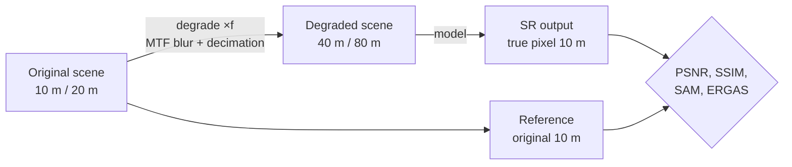

# Evaluation

Back to [Home](Home.md)

Sentinel-2 has no 2.5 m ground truth, so no single number can say which model is "right". The app therefore
scores every model in two complementary ways and leaves the visual check to you
([High-res reference](High-res-reference.md), Residuals tab).

## 1. Wald protocol: a test with a real reference

The scene is degraded by the model's own factor *f* (×4 for 10 → 2.5 m models, ×2 for 20 → 10 m sharpening), the
model is run on the degraded scene as if it were ordinary Sentinel-2, and its output, now at the original
pixel size, is compared with the original. Bands that would need an upsampled reference (e.g. 20 m bands in a ×4
test) are not scored; the table shows how many bands were scored.

| Metric | Meaning | Better |
|---|---|---|
| **PSNR** (dB) | Pixel error relative to the band's dynamic range (0.5–99.5 percentile) | higher |
| **SSIM** | Structural similarity (local means, contrasts, correlation) | higher (max 1) |
| **RMSE** | Root mean square error in reflectance units | lower |
| **SAM°** | Mean spectral angle between output and reference spectra, all scored bands | lower |
| **ERGAS** | Relative global error, normalised by the resolution ratio | lower |

> [!CAUTION]
> The Wald protocol assumes a model behaves the same at 40 → 10 m as at 10 → 2.5 m (scale invariance). Models
> trained on real high-resolution pairs (SEN2SR on NAIP/SPOT, Satlas on NAIP) can score lower here than they
> deserve, and GANs are penalised for plausible-but-not-identical texture. Compare models **with the same factor**
> and always against the bicubic baseline.

## 2. Real scene: no reference

The model runs on the actual scene. Its output is checked against what the sensor measured:

| Metric | How | Reading |
|---|---|---|
| **Consistency PSNR** | Output degraded back to each band's native pixel size vs. the input band | High = the SR image still *is* the observed image at 10/20 m |
| **\|bias\|** | Mean absolute brightness shift after that degradation | Near 0 |
| **corr** | Correlation of degraded output with input | Near 1 |
| **HF gain** | High-frequency energy (mean squared Laplacian) of the output ÷ that of bicubic | > 1 = sharper than interpolation |
| **SAM° vs bicubic** | Spectral angle between output and bicubic | Small = spectra preserved |

> [!TIP]
> Read them together. A blurry output passes consistency easily; HF gain alone rewards noise, ringing and
> blockiness (nearest-neighbour has a huge HF gain). A good model has HF gain clearly above 1 **and** consistency
> at least as high as bicubic **and** a small spectral angle.

## Degradation model

Both tests need to simulate "how the satellite would see this at coarser resolution":

- **mtf** (default): a Gaussian blur whose response at the coarse grid's Nyquist frequency equals Sentinel-2's
  pre-flight MTF for that band (≈ 0.22–0.34), followed by sampling at pixel centres. σ = f·√(−2 ln MTF)/π.
- **area**: a plain block mean.

`mtf` is physically closer to the sensor; `area` is simpler and slightly kinder to blurry models.

## Practical checklist

1. Run each learned model together with its baseline (`bicubic_x4` or `bicubic_20to10`).
2. Wald: does it beat the baseline on PSNR/SSIM? By how much?
3. Real: consistency PSNR ≥ baseline? HF gain > 1? SAM small?
4. Residuals → *Consistency*: structured patterns (edges, objects) mean the model altered measured signal.
5. Swipe over the high-res image: is the added detail real?
