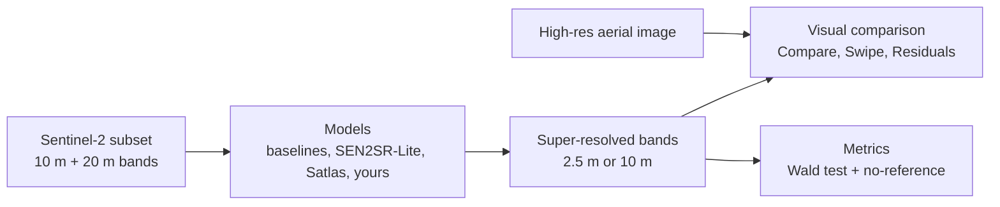

# S2 SR Bench

A local app for testing **super-resolution (SR) models on Sentinel-2 imagery**: load a scene, run several
models on exactly the same pixels, and compare them side by side, against a high-resolution aerial
image, and with quantitative metrics.

> [!NOTE]
> These notes form an [Obsidian](https://obsidian.md) vault: open the `docs` folder as a vault to
> browse them with backlinks and the graph view. They are plain Markdown with relative links, so they
> also read normally on GitHub.

## Start here

1. [Installation](Installation.md): one-time setup (Windows via WSL, or Linux).
2. [Sample scenes](Sample-scenes.md): download a ready-made test area.
3. [Using the app](Using-the-app.md): a tour of the sidebar and every tab.

## How it works

- [Data sources](Data-sources.md): STAC search, local GeoTIFF, `.SAFE`, samples; how reflectance is read.
- [Models](Models.md): what each model does, its inputs and outputs, and caveats.
- [Evaluation](Evaluation.md): the two scoring methods and how to read the metrics.
- [High-res reference](High-res-reference.md): overlaying results on aerial imagery.
- [Architecture](Architecture.md): code layout and data flow, for developers.

## Going further

- [Command line](Command-line.md): batch runs, sample downloads, scripted benchmarks.
- [Adding a model](Adding-a-model.md): plug in your own TorchScript, ONNX or PyTorch model.
- [Troubleshooting](Troubleshooting.md): GPU, Python-version and download problems seen in practice.
- [References](References.md): papers and upstream projects.

## The idea in one picture

There is no 2.5 m "truth" for Sentinel-2, so the app never relies on one number. It combines a degraded-input
test, consistency checks on the real scene, and your own eyes on an aerial image. See [Evaluation](Evaluation.md).
